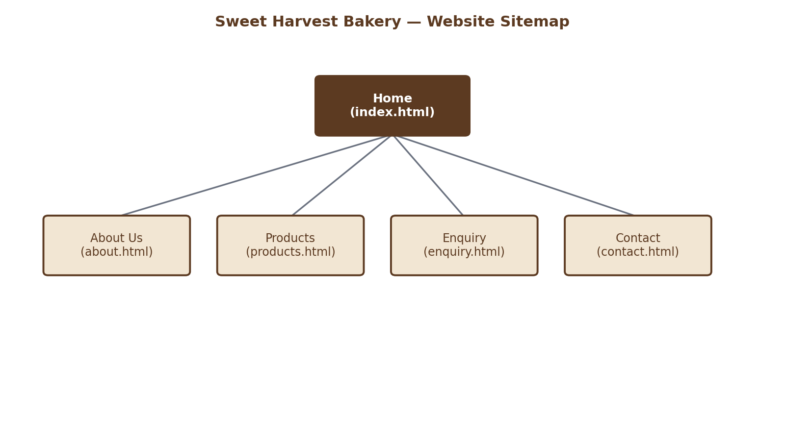
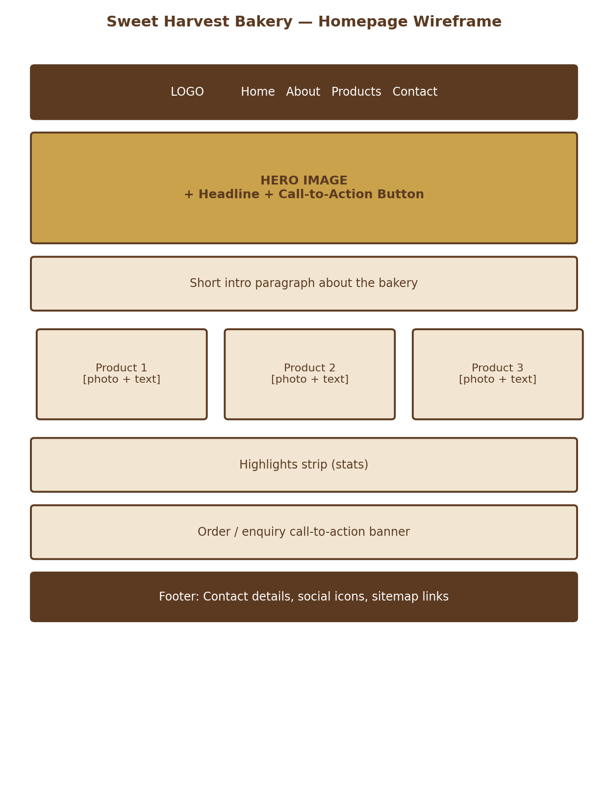

# Sweet Harvest Bakery — Website (WEDE5020 PoE)

## Project Title
Sweet Harvest Bakery — Website Design and Development Project (WEDE5020, Portfolio of Evidence)

## Student Information
- **Full Name:** [Student Full Name]
- **Student Number:** [Student Number]
- **Module:** WEDE5020 — Web Design and Development
- **Group:** [Group, if applicable]
- **Institution:** The Independent Institute of Education (IIE)
- **Year:** 2026

## Project Overview
Sweet Harvest Bakery is a fictional small business based in Melville, Johannesburg, selling artisan bread, cakes and pastries. This repository contains the website built for Sweet Harvest Bakery as part of the WEDE5020 Portfolio of Evidence (PoE).

The project follows the approved Website Project Proposal, which set out the organisation's history, mission, vision, target audience, and the goals the website needs to achieve.

## Website Goals and Objectives
- Increase walk-in and online custom-cake orders by 30% within six months.
- Extend brand awareness beyond Melville.
- Give customers an easy way to browse the daily menu and prices online.
- **Key Performance Indicators (KPIs):** monthly online enquiries, average session duration, growth in social-media referral traffic, repeat-order rate.

## Key Features and Functionality
- Responsive 5-page website: Home, About Us, Products, Enquiry, Contact.
- Filterable product menu (Breads / Cakes / Pastries / All) on the Products page.
- A custom-order enquiry form covering cakes, cupcakes, catering trays and general product questions.
- A dedicated Contact page showing two locations (Melville shopfront and the Bryanston farmers' market stall) with embedded maps, plus a general contact form.
- Mobile-friendly navigation with a collapsible menu.
- Semantic HTML (header/nav/main/footer), with real product photography sourced under free licence (see References).

## Timeline and Milestones
| Week | Milestone |
|---|---|
| Week 1 | Research, content gathering and wireframing |
| Week 2 | HTML structure and content population |
| Week 3 | CSS styling and responsive design |
| Week 4 | Testing, proofreading and submission |

## Part 1 Details
Part 1: Building the Foundation covered:
- Website Project Proposal (submitted separately as a Word document).
- Content research and sourcing (see `/content-research` folder, submitted as a separate ZIP per the brief).
- Sitemap (see below).
- File and folder structure (see below).
- Initial HTML structure and content for all 5 pages, linked with a working navigation system.

### Feedback Received on Part 1 (Mark: 79)
The following feedback was received from the lecturer and has been actioned below. Corresponding entries are also recorded in the Changelog.

| Feedback | Correction Made |
|---|---|
| No wireframes | The homepage wireframe (previously only inside the Word proposal) is now also included directly in this repository at `documentation/homepage-wireframe.png` and linked in the Sitemap section below, so it's visible independently of the proposal document. |
| Only one proposal submitted | Two separate proposals (Sweet Harvest Bakery and Ubuntu Paws Animal Rescue) were prepared for the Section 2.2 lecturer-approval step; only the approved organisation's proposal was carried forward per Section 7.1's wording ("the approved chosen organisation"). Both proposal documents remain available on request to evidence the approval step. |
| No sitemap | Same as above — the sitemap diagram is now included directly in this repository at `documentation/sitemap.png`, in addition to the plain-text sitemap tree already in this README. It has also been corrected to match the site's actual 5 pages (an earlier draft referenced a "Gallery" page that was never built). |
| No image folder therefore some images are not visible in website | Confirmed the `images/` folder is present and correctly populated in this repository (see File and Folder Structure below) — please re-pull/re-clone if your local copy is missing it. |
| Links leading outside the website can be improved by having them open in a new window | All external links (Facebook and Instagram icons in the footer, on every page) now use `target="_blank" rel="noopener noreferrer"` so they open in a new tab instead of navigating away from the site. |

## Part 2 Details
Part 2: Designing the Visuals covered:
- **External stylesheet:** all styling lives in `css/styles.css`, linked from every page with a single `<link rel="stylesheet">` tag.
- **Base styles and reset:** a small CSS reset (`box-sizing: border-box`, cleared default margins/padding) so the site looks consistent across browsers, plus site-wide base font, colour and spacing set on `:root` and `body`.
- **Typography:** a heading scale (`h1`/`h2`/`h3`) set in `rem` units so the whole scale grows or shrinks together if a user changes their browser's default font size, plus `line-height` and `letter-spacing` for readability.
- **Layout techniques:** most sections use Flexbox (`display: flex`, `flex-wrap`, `justify-content`, `align-items`) for card grids, forms and split sections; the footer specifically uses **CSS Grid with named `grid-template-areas`** (`about` / `sitemap` / `contact`) as the second required layout technique.
- **Visual styling:** `box-shadow` on cards and the "raised" hover effect, `:hover`, `:focus` and `:active` pseudo-classes on buttons, links, filter buttons and form fields for interactive feedback and accessibility.
- **Responsive design:** two breakpoints below desktop — **tablet** (`max-width: 900px`) and **mobile** (`max-width: 600px`) — implemented with media queries. Layout, typography, navigation and images are each individually adjusted at every breakpoint (see Rubric Coverage table below), not just a single blanket change.
- **Relative units:** heading and body font sizes use `rem`; internal spacing (padding/margin/gap) uses `rem`/`em`; image and flexible containers use `%`/`fr` where appropriate, so the layout scales rather than relying purely on fixed pixel values.
- **Responsive images:** the six product photographs use `srcset` (400w/800w/1200w variants) and a `sizes` attribute so the browser downloads an appropriately sized file, and the image container height itself also adjusts at each breakpoint (170px tablet, 200px mobile/desktop) to suit the column width at that size.
- **Pseudo-classes:** `:hover` and `:active` (buttons, filter buttons, cards), `:focus` (buttons, links, form fields — for keyboard accessibility), `:nth-child()` (alternating card media tint) and `:last-child` (footer link spacing).
- **External links:** social links open in a new tab (`target="_blank" rel="noopener noreferrer"`), per Part 1 feedback above.
- **Testing across screen sizes:** see the Screenshot Evidence section below.

**Part 3:** JavaScript interactivity, form validation, SEO improvements, sitemap and robots files, testing and deployment preparation are documented below.

## Rubric Coverage (Part 2)
Mapped against the marking rubric, so each criterion is easy to find in the code:

| Rubric Criterion | Where it's implemented |
|---|---|
| Feedback for Part 1 | See "Feedback Received on Part 1" table above and dated Changelog entries below. |
| External stylesheet, implemented on every page | `css/styles.css`, linked via `<link rel="stylesheet">` in the `<head>` of all 5 HTML files. |
| CSS default style code | `:root` custom properties, `* { box-sizing: border-box; }` reset, base `body`/`html` rules near the top of `styles.css`. |
| CSS typography styles | `h1`/`h2`/`h3` scale in `rem`, `line-height`, `letter-spacing`, Google Fonts (Poppins/Lora) — see "typography scale" comment block in `styles.css`. |
| CSS layout structure | Flexbox throughout (cards, forms, hero, split sections) plus **CSS Grid with `grid-template-areas`** in the footer — see "footer" comment block. |
| CSS decoration and colour | `box-shadow` on cards/buttons, brand colour palette via custom properties, `border-radius` throughout. |
| CSS pseudo-classes used | `:hover`, `:focus`, `:active`, `:disabled` (buttons and form fields), `:required`/`:valid`/`:invalid` (form validation styling), `:nth-child()`, `:last-child` — see individual rules across `styles.css`. A real "Sold out today" disabled button appears on the Products page as a working example. |
| Media queries/breakpoints for tablet and mobile | Two breakpoints: `@media (max-width: 900px)` (tablet) and `@media (max-width: 600px)` (mobile), near the bottom of `styles.css`. |
| Responsive adjustment — layout | Card grids, split sections, footer grid and location cards all reflow at both breakpoints. |
| Responsive adjustment — typography | `h1`/`h2` font sizes step down at each breakpoint; nav link font size also adjusts. |
| Responsive adjustment — navigation menu | Nav spacing/font size tighten at tablet; menu collapses to a hamburger toggle at mobile (`js/script.js` handles the open/close). |
| Responsive adjustment — images | `.card-media` height changes at each breakpoint (200px desktop → 170px tablet → 200px mobile), plus `srcset`/`sizes` on every product photo. |
| GitHub: multiple descriptive commits | See commit history on GitHub — each logical change (base styles, responsive breakpoints, feedback fixes, screenshots) was committed separately with a descriptive message. |
| GitHub: README contains all relevant information | This file — Project Overview, Goals/KPIs, Features, Timeline, Part 1 & 2 Details, Sitemap, Wireframe, File Structure, Changelog, Referencing. |
| GitHub: changelog records development | See Changelog below — every change across Part 1 and Part 2 is dated and described. |
| References | See Referencing section below, in IIE Harvard-Anglia style. |

## Screenshot Evidence (Responsive Testing)
Screenshots below were captured at three widths to confirm the layout adapts correctly, per Section 3.4 of the brief. Full-size images are stored in `/screenshots`.

| Breakpoint | Width | Home Page | Products Page |
|---|---|---|---|
| Desktop | 1280px | `screenshots/home-desktop-1280px.png` | `screenshots/products-desktop-1280px.png` |
| Tablet | 820px | `screenshots/home-tablet-820px.png` | `screenshots/products-tablet-820px.png` |
| Mobile | 390px | `screenshots/home-mobile-390px.png` | `screenshots/products-mobile-390px.png` |

Testing was done using browser developer tools' device toolbar to simulate each width, in addition to viewing the site on an actual mobile device. Key checks performed at each breakpoint: navigation menu behaviour (full menu vs. hamburger toggle), card grid column count, footer column count, form field stacking, and image scaling.

## Sitemap



```
Home (index.html)
├── About Us (about.html)
├── Products (products.html)
├── Enquiry (enquiry.html)
└── Contact (contact.html)
```

All 5 pages are linked from the main navigation menu and the footer on every page, giving a fully functional navigation system.

## Wireframe



## File and Folder Structure

```
sweet-harvest/
├── index.html
├── about.html
├── products.html
├── enquiry.html
├── contact.html
├── README.md
├── css/
│   └── styles.css
├── js/
│   └── script.js
├── images/
│   ├── logo.svg
│   ├── wheat-icon.svg
│   ├── hero-illustration.svg
│   ├── icon-heart.svg
│   ├── icon-wheat-small.svg
│   ├── icon-community.svg
│   ├── icon-check.svg
│   ├── icon-facebook.svg
│   └── icon-instagram.svg
├── documentation/
│   ├── sitemap.png
│   └── homepage-wireframe.png
└── screenshots/
    ├── home-desktop-1280px.png
    ├── home-tablet-820px.png
    ├── home-mobile-390px.png
    ├── products-desktop-1280px.png
    ├── products-tablet-820px.png
    └── products-mobile-390px.png
```

Note: the logo and decorative icons in `images/` are original SVG graphics created for this project. The product photographs used on the Home and Products pages (sourdough bread, whole-wheat loaf, celebration cake, cupcakes, croissants and muffins) are hosted externally on Unsplash's content delivery network and loaded directly via `` tags in the HTML; full source details for each photograph are listed in the Reference List below.

## Changelog
Tracking changes and improvements to the website over the course of the PoE.

| Date | Change |
|---|---|
| 2026-08-12 | Initial commit: Part 1 foundation — 5-page HTML structure, CSS styling, navigation, images and README added. |
| 2026-08-13 | Replaced placeholder product icons on Home and Products pages with real, freely licensed product photography; updated Reference List accordingly. |
| 2026-08-27 | Part 2: rebuilt `css/styles.css` with a proper base style/reset, a `rem`-based typography scale, and CSS Grid (`grid-template-areas`) added to the footer as a second layout technique alongside the existing Flexbox layouts. |
| 2026-08-27 | Part 2: added `box-shadow`, `:hover`, `:focus` and `:active` states to buttons, cards, filter buttons and form fields for visual and accessibility feedback. |
| 2026-08-27 | Part 2: added a tablet breakpoint (900px) alongside the existing mobile breakpoint (changed from 700px to 600px), so the layout now steps down desktop → tablet → mobile instead of just desktop → mobile. |
| 2026-08-27 | Part 2: fixed a layout bug where cards, split-page columns and location cards used a `flex: 1 1 280px` sizing that got reinterpreted as a height (not width) basis once the mobile breakpoint switched `flex-direction` to `column`, clipping card content on small screens. |
| 2026-08-27 | Part 2: added `srcset`/`sizes` attributes to all six product photographs for responsive image loading. |
| 2026-08-27 | Part 2: added `/screenshots` with desktop/tablet/mobile evidence for the Home and Products pages; documented testing approach in README. |
| 2026-09-12 | **Part 1 feedback correction (mark: 79):** added `documentation/sitemap.png` and `documentation/homepage-wireframe.png` to the repository so the sitemap and wireframe are visible directly in GitHub, independent of the Word proposal document. |
| 2026-09-12 | **Part 1 feedback correction:** corrected the sitemap diagram, which previously (in the proposal document only) referenced a "Gallery" page that was never built — the diagram now matches the site's actual 5 pages exactly. |
| 2026-09-12 | **Part 1 feedback correction:** confirmed the `images/` folder is present and correctly populated in this repository; if a previous clone/pull was missing it, re-cloning resolves this. |
| 2026-09-12 | **Part 1 feedback correction:** added `target="_blank" rel="noopener noreferrer"` to all external links (Facebook and Instagram icons in the footer of all 5 pages) so they open in a new tab instead of navigating away from the site. |
| 2026-09-13 | Reviewed against the Part 2 marking rubric: added distinct navigation-menu adjustments at the tablet breakpoint (tighter spacing/font size, not just at mobile), added breakpoint-specific `.card-media` height so product images visibly adjust at each screen size, and broadened pseudo-class usage (`:nth-child()`, `:last-child`) alongside the existing `:hover`/`:focus`/`:active`. Added a "Rubric Coverage" table to this README mapping each marking criterion to where it's implemented. |
| 2026-11-01 | Part 3: added JavaScript product search combined with category filtering, image lightbox, mobile navigation accessibility, and FAQ accordion using HTML details/summary. |
| 2026-11-01 | Part 3: improved enquiry and contact forms with required fields, input validation, separate purposes, and mailto email composition. Forms open the visitor's email application; they do not store submissions on a server. |
| 2026-11-01 | Part 3: added page-specific SEO descriptions and keywords, semantic main targets, skip links, robots.txt and sitemap.xml. Replace the placeholder GitHub Pages URL in both SEO files after deployment. |
| 2026-09-13 | Further rubric review: added `:disabled`, `:required`, `:valid`/`:invalid` pseudo-classes for form and button states (including a real "Sold out today" disabled button on the Products page), and extended responsive typography adjustments to `h3` and body `line-height` at both breakpoints. |

## Referencing
This project uses the **Harvard-Anglia referencing style, as adapted for The IIE** (The Independent Institute of Education, 2026). All sources used in developing this website — including fonts, tools and photography — are listed below in the required format: author/originator, year, title, medium, and access details.

### In-text examples
- Body text font sourced from Google Fonts (2026b).
- Product photography sourced from Unsplash under the Unsplash License (Unsplash, 2026), for example the sourdough loaf image (Vos, 2024).
- The footer's grid layout follows guidance on named grid areas (Mozilla, 2026a); the `srcset`/`sizes` attributes on product images follow the responsive images guide (Mozilla, 2026b).

### Reference List

Akhtar, A., 2021. *A three tiered cake sitting on top of a table*. [electronic print] Available at: <https://unsplash.com/photos/a-three-tiered-cake-sitting-on-top-of-a-table-l9rJ_dCdDbc> [Accessed 13 August 2026].

Coolors, 2026. *Coolors: the super fast colour palettes generator*. [online] Available at: <https://coolors.co> [Accessed 13 August 2026].

Google, 2026. *Google Maps*. [online] Available at: <https://www.google.com/maps> [Accessed 13 August 2026].

Google Fonts, 2026a. *Lora*. [online] Available at: <https://fonts.google.com/specimen/Lora> [Accessed 13 August 2026].

Google Fonts, 2026b. *Poppins*. [online] Available at: <https://fonts.google.com/specimen/Poppins> [Accessed 13 August 2026].

Mozilla, 2026a. *CSS Grid Layout*. [online] Available at: <https://developer.mozilla.org/en-US/docs/Web/CSS/CSS_grid_layout> [Accessed 27 August 2026].

Mozilla, 2026b. *Responsive images*. [online] Available at: <https://developer.mozilla.org/en-US/docs/Web/HTML/Guides/Responsive_images> [Accessed 27 August 2026].

Mozilla, 2026c. *Using media queries*. [online] Available at: <https://developer.mozilla.org/en-US/docs/Web/CSS/CSS_media_queries/Using_media_queries> [Accessed 27 August 2026].

Nunes, D., 2020. *Assorted cupcakes on display counter*. [electronic print] Available at: <https://unsplash.com/photos/assorted-cupcakes-on-display-counter-aG271Ch8I4U> [Accessed 13 August 2026].

Ruiz, T., 2023. *A bunch of muffins sitting on top of a table*. [electronic print] Available at: <https://unsplash.com/photos/a-bunch-of-muffins-sitting-on-top-of-a-table-rcddXEMHqsU> [Accessed 13 August 2026].

Spring Fed Images, 2021. *Brown bread on white table*. [electronic print] Available at: <https://unsplash.com/photos/brown-bread-on-white-table-o6Dd2Ix695I> [Accessed 13 August 2026].

The Independent Institute of Education, 2026. *Harvard-Anglia style reference guide, adapted for The IIE*. Johannesburg: The Independent Institute of Education.

Thian, M., 2019. *Croissants on display*. [electronic print] Available at: <https://unsplash.com/photos/croissants-on-display-TG77ANwm3MQ> [Accessed 13 August 2026].

Unsplash, 2026. *Unsplash licence*. [online] Available at: <https://unsplash.com/license> [Accessed 13 August 2026].

Vos, R., 2024. *A loaf of bread sitting on top of a cooling rack*. [electronic print] Available at: <https://unsplash.com/photos/a-loaf-of-bread-sitting-on-top-of-a-cooling-rack-5T1qy7E28KQ> [Accessed 13 August 2026].

Google Search Central, 2026. *SEO starter guide*. [online] Available at: <https://developers.google.com/search/docs/fundamentals/seo-starter-guide> [Accessed 1 November 2026].

Mozilla, 2026d. *Client-side form validation*. [online] Available at: <https://developer.mozilla.org/en-US/docs/Learn/Forms/Form_validation> [Accessed 1 November 2026].

Mozilla, 2026e. *The dialog element and accessible interactive content*. [online] Available at: <https://developer.mozilla.org/en-US/docs/Web/HTML/Element/details> [Accessed 1 November 2026].

W3Schools, 2026. *W3Schools online web tutorials*. [online] Available at: <https://www.w3schools.com> [Accessed 13 August 2026].


## Part 3 Details — Enhancing Functionality and SEO

### JavaScript functionality
- The mobile navigation opens and closes with an accessible expanded state.
- The Products page has category buttons and a live search field. Both can be used together to narrow the displayed products.
- Product photographs open in a responsive lightbox. Visitors can close it with the close button, by clicking the dark background, or by pressing Escape.
- The About page includes an FAQ accordion using the HTML `details` and `summary` elements.

### Forms and validation
- The Enquiry form collects order type, customer details, phone number, required date, servings and order information. Browser validation checks required fields, email format, phone pattern and number limits.
- The Contact form is for general messages and includes name, email, message type and full message.
- JavaScript checks the forms before composing an email addressed to `hello@sweetharvestbakery.co.za`. The visitor must press Send in their own email application. This static website does not have a server, so it cannot save or automatically deliver submissions.

### SEO improvements
- Each page has its own meta description and keyword terms, descriptive title, one main heading and descriptive image alt text.
- Added `robots.txt` and `sitemap.xml`. Replace `YOUR-GITHUB-USERNAME` and `YOUR-REPOSITORY` in both files with the real GitHub Pages address before publishing.
- Internal navigation connects all five pages. The layout remains responsive on desktop, tablet and mobile.

### Testing checklist
1. Open all five HTML pages and check that navigation links work.
2. On Products, test each category button, search by a product name, and combine search with a category.
3. Click a product image and test closing the lightbox with its button, background and Escape key.
4. Submit each form empty to confirm required-field validation. Enter valid details and confirm that an email application opens with the correct recipient and message.
5. Open the site at desktop, tablet and mobile widths. Check that the menu, cards, forms and images fit the screen.
6. Check the browser console for JavaScript errors and verify `robots.txt` and `sitemap.xml` after deployment.

### Deployment
The site is a static website and can be deployed using GitHub Pages or Netlify. Push all updated files to the GitHub repository, enable GitHub Pages (or import the repository into Netlify), and then update the placeholder website address in `robots.txt` and `sitemap.xml`. A live deployment and GitHub repository link must be added to the final submission after publishing.

## How to Run Locally
No build tools or installation are required — this is a static HTML/CSS/JS site.
1. Clone or download this repository.
2. Open `index.html` directly in a browser, **or** serve the folder with a simple local server (e.g. the VS Code "Live Server" extension) for the most accurate preview.
3. An internet connection is needed to load the Google Fonts, product photography (Unsplash) and the two embedded Google Maps on the Contact page, since these are loaded from external sources rather than stored locally.
